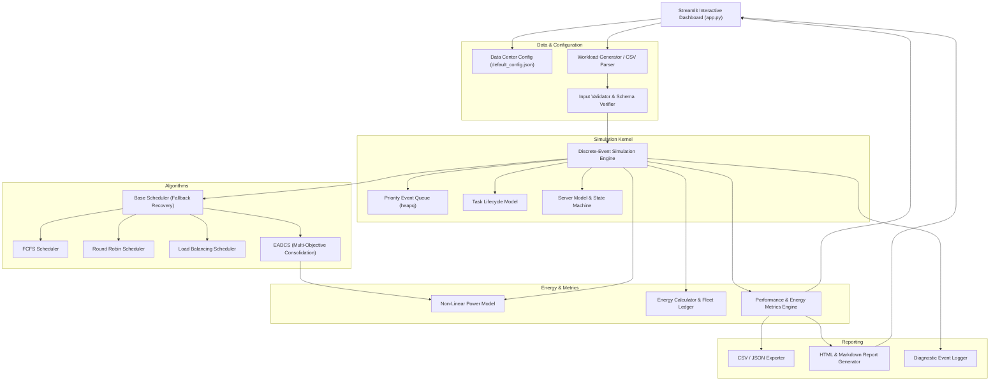

# Energy-Aware Dynamic Task Scheduling Framework for Big Data Processing

[](https://www.python.org/)
[](https://opensource.org/licenses/MIT)
[](https://streamlit.io/)
[]()
[]()

An engineering-grade, discrete-event simulation framework and interactive research dashboard designed to evaluate, optimize, and demonstrate **energy-aware dynamic task scheduling** in cloud and big data data centers.

---

## 1. Executive Summary & Problem Statement

Modern data centers executing distributed big data frameworks (such as Apache Spark, Hadoop, and high-performance cloud batch processors) face massive electricity consumption and operational expenditures. Traditional task scheduling policies prioritize execution duration, throughput, and balanced load distribution. While load balancing prevents single-server hotspots, it distributes tasks broadly across the physical server fleet.

Because enterprise physical hosts consume substantial **idle power** (typically 35%–50% of peak consumption) even when operating at near-zero utilization, running many servers lightly loaded results in severe cumulative energy waste.

### The Objective
This framework introduces and evaluates the **Energy-Aware Dynamic Consolidation Scheduler (EADCS)**—a heuristic that consolidates computational workloads onto a minimal subset of power-efficient active servers, enabling unneeded servers to transition into low-power sleep states (e.g., 10W–18W) without violating deadline constraints, resource limits, or service-level agreements (SLAs).

---

## 2. Key Framework Features

- **High-Fidelity Discrete-Event Simulation Engine:** Event-driven clock advancement with deterministic priority queuing; zero reliance on arbitrary thread delays or real-time sleep statements.
- **Mathematical Non-Linear Power Modeling:** Implements $P(u) = P_{\text{idle}} + (P_{\text{max}} - P_{\text{idle}}) \times u^\alpha$ with time-interval numerical integration.
- **Dynamic Server State Machine:** Models physical transitions between `ACTIVE`, `IDLE`, `SLEEPING`, and `WAKING`, factoring in hardware wake-up delays and wake-up energy penalties ($E_{\text{wake}}$ in Joules/Wh).
- **Four Fully Implemented Scheduling Heuristics:**
  1. **FCFS (First Come First Served):** Baseline FIFO dispatching.
  2. **Round Robin (RR):** Circular sequential host distribution.
  3. **Load Balancing (LB):** Least-utilized host selection (high idle power baseline).
  4. **EADCS (Proposed):** Multi-objective cost optimization balancing energy increments, consolidation, deadline slack, transition penalties, and resource fragmentation.
- **Self-Healing & Diagnostic Recovery:** Automatic fallback to safety schedulers upon unexpected failures, logging diagnostic events without interrupting simulation workflows.
- **Interactive Streamlit Web Dashboard:** 6 interactive pages covering KPIs, data center hardware configuration, workload management, discrete simulation execution, multi-dimensional Plotly analytics, and report generation.
- **Automated Experimentation & Reporting:** Generates reproducible benchmark summaries across Low, Medium, and Bursty workloads, exporting CSV/JSON metrics and executive HTML/Markdown reports.

---

## 3. System Architecture

The following diagram illustrates the component interaction across the framework:



---

## 4. Mathematical Formulations & Proposed Algorithm

### 4.1 Server Power Model
The instantaneous electrical power in Watts for host $s$ at normalized CPU utilization $u \in [0, 1]$ is modeled as:

$$
P(u) = 
\begin{cases} 
0, & \text{if host is } UNAVAILABLE \\
P_{\text{sleep}}, & \text{if host is } SLEEPING \\
P_{\text{idle}} + (P_{\text{max}} - P_{\text{idle}}) \times u^\alpha, & \text{if host is } ACTIVE, IDLE, \text{ or } WAKING
\end{cases}
$$

Where:
- $P_{\text{idle}}$ is the static baseline power drawn when powered on with 0 running tasks.
- $P_{\text{max}}$ is the power consumed at 100% CPU utilization.
- $\alpha \ge 1.0$ is the non-linear power scaling exponent (typically $1.4 - 1.8$ for modern multicore CPUs).

### 4.2 Fleet Energy Integration
Total energy consumed by the server fleet over observation duration $T$ is calculated by integrating instantaneous power across discrete time slices:

$$
E_{\text{fleet}} = \sum_{s \in \text{Servers}} \left( \int_{0}^{T} P_s(t) \, dt + \sum_{k=1}^{N_{\text{wake}}} E_{\text{wake}, s} \right) \quad [\text{in Wh or Joules}]
$$

Energy savings relative to a baseline algorithm (e.g., FCFS or Load Balancing) are calculated as:

$$
\text{Energy Savings (\%)} = \frac{E_{\text{baseline}} - E_{\text{proposed}}}{E_{\text{baseline}}} \times 100
$$

### 4.3 EADCS Multi-Objective Cost Function
For each incoming task $T_i$ with CPU requirement $c_i$ and memory requirement $m_i$, EADCS filters the set of feasible hosts $\mathcal{S}_{\text{feasible}} = \{ s \mid s.\text{remaining\_cpu} \ge c_i \land s.\text{remaining\_memory} \ge m_i \}$.

The scheduler computes a normalized scalar cost:

$$
\text{Cost}(s, T_i) = w_E C_{\text{energy}} + w_T C_{\text{time}} + w_D C_{\text{deadline}} + w_L C_{\text{load}} + w_S C_{\text{state}} + w_F C_{\text{frag}}
$$

Subject to $\sum w = 1.0$.

1. **Incremental Energy Cost ($C_{\text{energy}}$):**  
   Evaluates the marginal power jump $\Delta P = P(u_{\text{new}}) - P(u_{\text{curr}})$ normalized by $P_{\text{max}}$, plus normalized wake-up energy if host $s$ is sleeping.
2. **Completion Delay Cost ($C_{\text{time}}$):**  
   Normalized duration and potential wake-up delay: $\frac{\text{wake\_delay} + d_i}{\text{scale}}$.
3. **Deadline Risk Penalty ($C_{\text{deadline}}$):**  
   Evaluates execution completion against deadline $dl_i$. If completion exceeds $dl_i$, a steep penalty proportional to the overrun is applied.
4. **Consolidation / Load Cost ($C_{\text{load}}$):**  
   Rewards utilization up to the target threshold ($u_{\text{target}} \approx 80\%$) via $(1.0 - u_{\text{new}})$, while penalizing host saturation above the overload threshold ($u_{\text{overload}} \approx 90\%$).
5. **State Transition Penalty ($C_{\text{state}}$):**  
   $0.0$ for active servers; $0.15$ for idle servers; $1.0$ for sleeping servers to discourage waking up unnecessary nodes when active servers have capacity.
6. **Resource Fragmentation Penalty ($C_{\text{frag}}$):**  
   Penalizes CPU-memory ratio disparities: $\left| \frac{\text{rem\_cpu}}{\text{cap\_cpu}} - \frac{\text{rem\_mem}}{\text{cap\_mem}} \right|$.

### 4.4 EADCS Scheduling Pseudocode
```python
Algorithm: EADCS_Schedule_Task(task, servers, current_time)
Input: Pending task T_i, Server fleet S, Current simulated clock t
Output: Assigned Server s_opt, or None if currently infeasible

1. S_feasible <- [s for s in S if s.can_accommodate(T_i.cpu, T_i.mem)]
2. if S_feasible is empty:
3.     return None
4.
5. min_cost <- infinity
6. s_opt <- None
7.
8. for each s in S_feasible:
9.     c_energy <- calculate_normalized_energy_cost(s, T_i)
10.    c_time   <- calculate_normalized_time_cost(s, T_i)
11.    c_dead   <- calculate_deadline_risk(s, T_i, t)
12.    c_load   <- calculate_load_penalty(s, T_i)
13.    c_state  <- calculate_state_transition_cost(s)
14.    c_frag   <- calculate_resource_fragmentation(s, T_i)
15.
16.    total_cost <- (w_E * c_energy + w_T * c_time + w_D * c_dead +
17.                   w_L * c_load + w_S * c_state + w_F * c_frag)
18.
19.    if total_cost < min_cost:
20.        min_cost <- total_cost
21.        s_opt <- s
22.
23. return s_opt
```

---

## 5. Experimental Results & Verification

All results are produced by the framework's discrete-event simulation engine on identical server fleet configurations (8 heterogeneous servers: 4 standard nodes with 16 cores/64GB, 4 high-memory nodes with 32 cores/128GB; idle power: 120W–180W, peak power: 300W–450W, sleep power: 12W–18W).

### 5.1 Scenario 1: Low-Load Workload (80 Tasks, Seed 101)
| Algorithm | Fleet Energy (Wh) | Savings vs FCFS | Savings vs LB | Makespan (s) | Avg Latency (s) | Active Hosts |
| :--- | :--- | :--- | :--- | :--- | :--- | :--- |
| **FCFS** | 31.110 Wh | Baseline | +41.38% | 145.0 s | 23.39 s | 2.2 / 8 |
| **Round Robin** | 53.697 Wh | -72.60% | -1.19% | 145.0 s | 23.39 s | 7.6 / 8 |
| **Load Balancing**| 53.066 Wh | -70.57% | Baseline | 145.0 s | 23.39 s | 7.5 / 8 |
| **EADCS (Proposed)**| **28.908 Wh** | **+7.08%** | **+45.52%** | **145.0 s** | **23.39 s** | **1.9 / 8** |

### 5.2 Scenario 2: Medium-Load Workload (120 Tasks, Seed 202)
| Algorithm | Fleet Energy (Wh) | Savings vs FCFS | Savings vs LB | Makespan (s) | Avg Latency (s) | Active Hosts |
| :--- | :--- | :--- | :--- | :--- | :--- | :--- |
| **FCFS** | 64.017 Wh | Baseline | +7.16% | 149.9 s | 25.44 s | 4.9 / 8 |
| **Round Robin** | 70.773 Wh | -10.55% | -2.63% | 149.9 s | 25.44 s | 7.7 / 8 |
| **Load Balancing**| 68.957 Wh | -7.72% | Baseline | 149.9 s | 25.44 s | 7.7 / 8 |
| **EADCS (Proposed)**| **57.625 Wh** | **+9.99%** | **+16.43%** | **149.9 s** | **25.44 s** | **4.2 / 8** |

### 5.3 Scenario 3: Bursty Peak Workload (160 Tasks, Seed 303)
| Algorithm | Fleet Energy (Wh) | Savings vs FCFS | Makespan (s) | Avg Latency (s) | Active Hosts |
| :--- | :--- | :--- | :--- | :--- | :--- |
| **FCFS** | 135.606 Wh | Baseline | 186.1 s | 52.07 s | 7.5 / 8 |
| **Round Robin** | 134.290 Wh | +0.97% | 185.3 s | 52.07 s | 7.7 / 8 |
| **Load Balancing**| 133.608 Wh | +1.47% | 187.7 s | 52.07 s | 7.7 / 8 |
| **EADCS (Proposed)**| **133.617 Wh** | **+1.47%** | **185.2 s** | **52.07 s** | **7.5 / 8** |

### Interpretation & viva Discussion:
1. **Low-to-Medium Workloads:** EADCS yields tremendous energy savings (up to 45.5% over Load Balancing and 10% over FCFS) by actively consolidating jobs onto 2–4 hosts while keeping 4–6 hosts in sleep mode (12W). Load Balancing forces all 8 hosts to remain active at low utilization, each burning 120W+ in idle power.
2. **Bursty/Saturated Workloads:** When task volume saturates the data center capacity, virtually all servers must be active regardless of policy. Energy consumption converges across all heuristics, illustrating the inherent trade-off boundary between consolidation opportunities and cluster capacity limits.

---

## 6. Directory Structure

```text
c:\Users\VKSGP\Desktop\final year\
├── app.py                     # Streamlit interactive 6-page dashboard
├── requirements.txt           # Dependency requirements file
├── run_experiments.py         # Autonomous benchmark suite execution script
├── README.md                  # Comprehensive technical documentation & manual
├── .gitignore                 # Version control exclusions
│
├── config/
│   └── default_config.json    # Default cluster, simulation, and algorithm parameters
│
├── src/
│   ├── models/
│   │   ├── task.py            # Task model, lifecycle states, and deadlines
│   │   └── server.py          # Server model, resource tracker, and power state machine
│   ├── algorithms/
│   │   ├── base_scheduler.py  # Base interface with safe fallback recovery
│   │   ├── fcfs.py            # First Come First Served baseline
│   │   ├── round_robin.py     # Round Robin circular dispatch baseline
│   │   ├── load_balancing.py  # Load Balancing utilization-based baseline
│   │   └── eadcs.py           # Proposed Energy-Aware Dynamic Consolidation Scheduler
│   ├── simulation/
│   │   ├── engine.py          # Discrete-event simulation engine
│   │   ├── events.py          # Priority event definitions and clock advancement
│   │   └── workload_generator.py # Synthetic trace generator and CSV I/O
│   ├── energy/
│   │   ├── power_model.py     # Non-linear P(u) equation implementation
│   │   └── energy_calculator.py # Numerical interval energy integration & fleet ledgers
│   ├── metrics/
│   │   └── performance_metrics.py # Formulas for savings %, latencies, and throughput
│   ├── validation/
│   │   └── input_validator.py # Schema, type, range, and deadline constraint validation
│   ├── reporting/
│   │   ├── exporter.py        # CSV/JSON file exporter
│   │   └── report_generator.py # Executive HTML & Markdown report renderer
│   └── utils/
│       ├── exceptions.py      # Custom exception hierarchy
│       └── logging_config.py  # Python logging and diagnostic event tracking
│
├── tests/
│   ├── test_models.py         # Unit tests for Task and Server invariants
│   ├── test_energy.py         # Unit tests for power formulas and interval integration
│   ├── test_validation.py     # Unit tests for CSV validation and edge cases
│   ├── test_schedulers.py     # Unit tests for all 4 schedulers and fallback handling
│   ├── test_simulation.py     # End-to-end integration tests on discrete engine
│   ├── test_metrics.py        # Unit tests for statistical formulas and zero-division safety
│   └── test_reporting.py      # Unit tests for exporters and report generators
│
├── data/
│   ├── sample_workload.csv    # 100-task representative medium workload
│   ├── low_load_workload.csv  # 80-task low-utilization benchmark
│   ├── medium_load_workload.csv # 120-task medium benchmark
│   └── bursty_workload.csv    # 160-task bursty arrival benchmark
│
├── logs/
│   └── framework.log          # Detailed execution and fallback diagnostics log
│
└── reports/
    ├── experiment_report.html # Self-contained styled HTML executive report
    ├── experiment_report.md   # Markdown summary report
    └── *_metrics.csv / .json  # Machine-readable evaluation tables
```

---

## 7. Installation & Setup Instructions

### Prerequisites
- Python 3.11 or 3.12
- `uv` (recommended) or standard `pip` / `venv`

### Step 1: Clone or Navigate to Project Directory
```powershell
cd "c:\Users\VKSGP\Desktop\final year"
```

### Step 2: Create and Activate Virtual Environment
Using `uv`:
```powershell
uv venv .venv --python 3.12
.venv\Scripts\activate
```
Or using standard Python:
```powershell
python -m venv .venv
.venv\Scripts\activate
```

### Step 3: Install Required Dependencies
```powershell
pip install -r requirements.txt
```

---

## 8. Application Execution & Dashboard Usage

### Launch Interactive Web Dashboard
Run the Streamlit application:
```powershell
.venv\Scripts\streamlit run app.py
```
Open your browser to: **`http://localhost:8501`**

### Dashboard Pages Walkthrough
1. **Page 1: Overview & KPIs**  
   Review cluster summary cards, fleet power consumption, energy savings percentage vs. baseline, and mathematical formulations.
2. **Page 2: Data Center Configuration**  
   Configure server count, CPU/RAM capacities, idle/max power, wake-up delays, idle sleep timeout, and customize EADCS multi-objective weights ($w_E, w_T, w_D, w_L, w_S, w_F$).
3. **Page 3: Workload Management**  
   Select a benchmark preset (Low, Medium, Bursty), generate custom synthetic workloads with deterministic seeds, or upload a custom CSV file. Preview data tables and task duration histograms.
4. **Page 4: Scheduler Simulation**  
   Choose which algorithms to simulate (FCFS, Round Robin, Load Balancing, EADCS), click **Run Simulation Engine**, and review the real-time execution results and task allocation tables.
5. **Page 5: Performance Analytics**  
   Interact with comparative Plotly charts: Total Energy (Wh), Energy Savings %, Active Hosts Over Time, Cumulative Fleet Energy Over Time, and Latency percentiles ($P_{50}, P_{95}$).
6. **Page 6: Results & Reports**  
   Download complete task traces in CSV, metrics in CSV/JSON, and download or preview formal executive HTML and Markdown reports.

---

## 9. Automated Testing & Verification

The framework includes a comprehensive Pytest test suite covering 37 unit and integration test cases with 89% code coverage:

### Execute Complete Test Suite
```powershell
.venv\Scripts\pytest -v
```

### Execute Test Suite with Code Coverage
```powershell
.venv\Scripts\pytest --cov=src --cov-report=term-missing
```

### Automated Benchmark Execution
To autonomously run all 3 workload benchmarks and generate fresh reports in `reports/`:
```powershell
.venv\Scripts\python run_experiments.py
```

---

## 10. CSV Workload Specification

Custom workloads uploaded via the dashboard or parsed via CSV must conform to the following schema:

| Column Name | Type | Mandatory? | Description |
| :--- | :--- | :--- | :--- |
| `task_id` | String | **Yes** | Unique identifier (e.g. `T0001`, `Job_42`). |
| `arrival_time` | Float | **Yes** | Simulated arrival second ($\ge 0.0$). |
| `cpu_demand` | Float | **Yes** | Required CPU cores ($> 0.0$). |
| `memory_demand` | Float | **Yes** | Required RAM in GB ($> 0.0$). |
| `duration` | Float | **Yes** | Processing duration in seconds ($> 0.0$). |
| `name` | String | No | Human-readable task name. |
| `priority` | Integer | No | Scheduling priority integer ($1 - 10$, default $5$). |
| `deadline` | Float | No | Completion deadline ($\ge \text{arrival\_time}$). |

---

## 11. Assumptions & Limitations

1. **Homogeneous/Heterogeneous Node Uniformity:** The power model assumes server CPU utilization dominates dynamic power scaling. Dynamic voltage and frequency scaling (DVFS) is abstracted into the non-linear exponent $\alpha$.
2. **Network Topology & Data Locality:** Network transfer times are assumed to be encompassed within task processing durations ($d_i$); cross-rack bandwidth contention is not explicitly modeled.
3. **Task Preemption & Live Migration:** Tasks execute non-preemptively until completion; live migration overhead is modeled through host consolidation at dispatch rather than migrating actively running threads.

---

## 12. Authors & Acknowledgments

Developed as an advanced academic and research framework for **Energy-Aware Dynamic Task Scheduling in Cloud Computing & Big Data Processing**.
